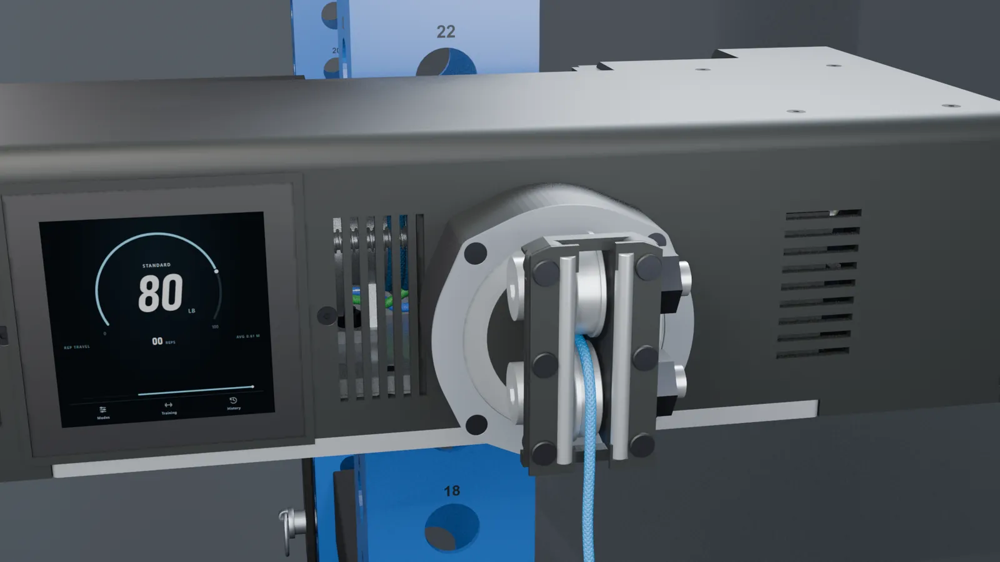
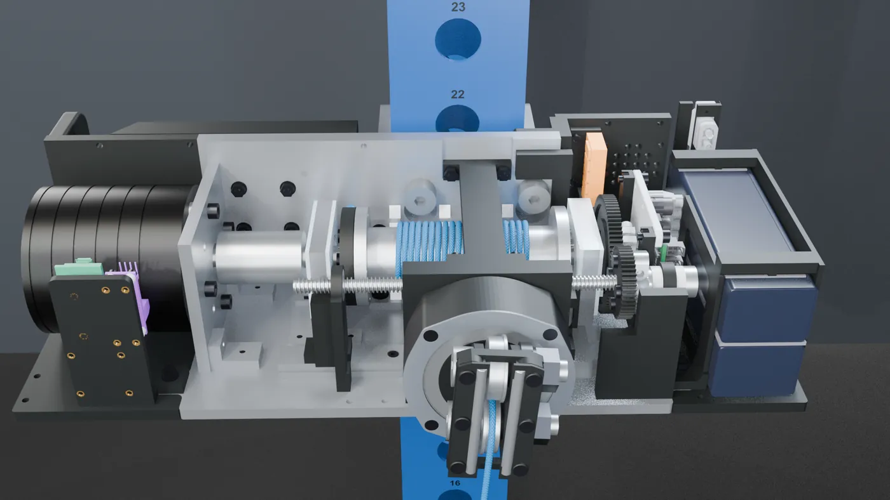
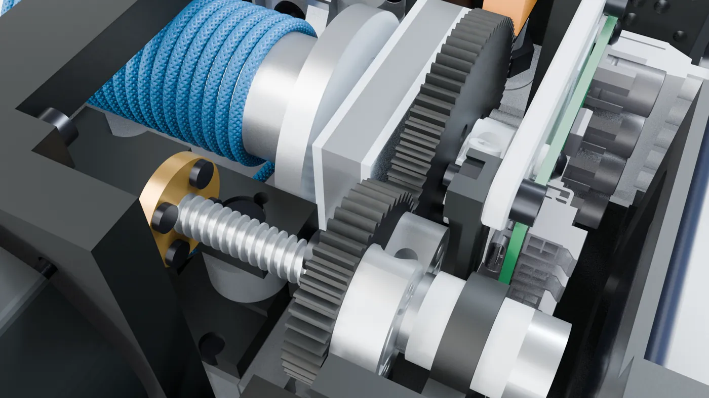
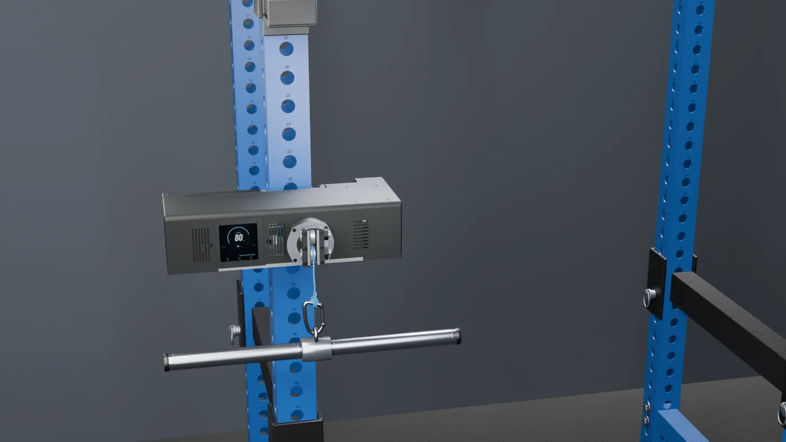
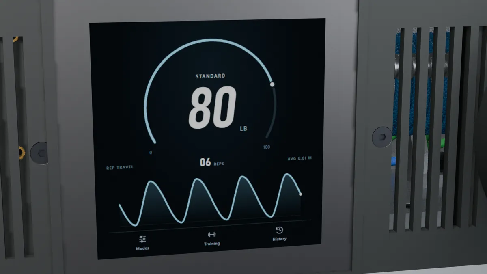
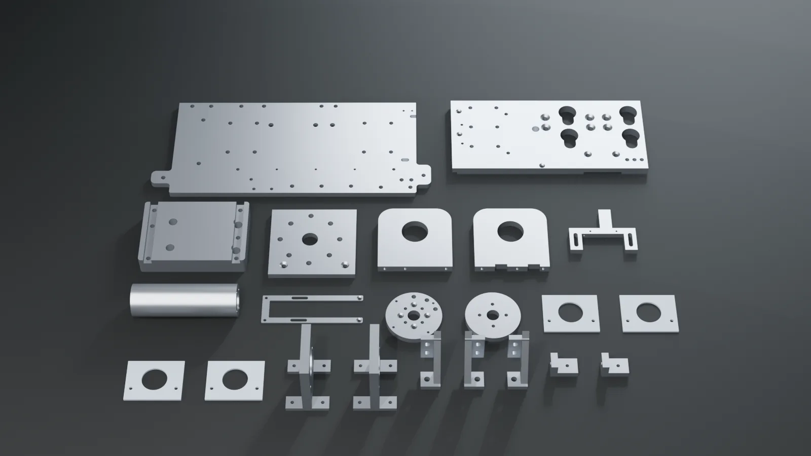

<h1 align="center">Kinetiq Gym</h1>

<b>A programmable smart gym, built as open hardware.</b> 
<a href="https://kinetiqgym.com">kinetiqgym.com</a> · <a href="https://kinetiqgym.com/build">The build</a> · <a href="https://kinetiqgym.com/build#parts">Parts &amp; cost</a> · <a href="https://kinetiqgym.com/build#software">App</a> · <a href="https://kinetiqgym.com/#support">Support</a> · <a href="docs/roadmap.md">Roadmap</a> · <a href="https://kinetiqgym.com/#join">Follow the build &amp; kit waitlist</a>

A direct-drive motor turns a rope drum, a geared level-wind lays the rope, and the controller sets the resistance in software.
It mounts on a rack upright. The design is built to be trained with, built, modified and programmed.

> **Status: open hardware in development.** The design is complete in CAD and the printed fit test is done. The aluminum
> prototype is being built now. **The CAD, build files and software are released after the prototype has been built and
> load-tested**, so what you download is something that has actually worked. Until then, this repository holds the website,
> the documentation and the renders.

| | |
|---|---|
|  |  |
|  |  |

Renders of the engineered design (Blender). The display content is illustrative.

## What it does

- **Programmable resistance:** a motor and a cable drum stand in for the weight stack, so the load is set in software.
- **Adjustable position:** it hangs on a rack upright at the height you want, and the cable exit swivels to follow the pull.
- **Training modes in software:** eccentric, chain-style and band-style resistance are designed as modes, not attachments.
- **Customizable hardware:** one bolted aluminum frame, five motor and power builds, two battery sizes.
- **Local and hackable:** its own controller and a Raspberry Pi, with no account or cloud service in the loop.

## The five builds

All five share the bolted 6061 aluminum frame (no welding), the drum, the level-wind and the exit. The drive is direct: no belt or gear
between the motor and the drum. Current parts lists and prices for each are on the
[build preview](https://kinetiqgym.com/build#parts).

| Build | Max rope force | Controller | Power | Size |
|---|---|---|---|---|
| APS 8072S 50 Kv (main build) | 158 lb | ODrive Pro | 10S battery (2 x 5S LiPo) | 400 x 227 x 103 mm |
| Lite: APS 8072S ~25 Kv | 158 lb | ODrive S1 | 36 V wall supply inside | 400 x 227 x 103 mm |
| MP80100 50 Kv | 158 lb | ODrive Pro | 10S battery | 444 x 227 x 103 mm |
| MP80100 rewired wye, ~29 Kv | 220 lb peak | ODrive Pro | 10S battery | 444 x 227 x 103 mm |
| APS C80100, custom ~25 Kv | 220 lb peak | ODrive Pro | 10S battery | 429 x 227 x 103 mm |

Every rating is a design target until the prototype is load-tested.

## In this repository

| Path | What |
|---|---|
| `site/` | kinetiqgym.com: the front page, the build preview, the parts data (`site/data/`) and the reference docs (`site/docs/`) |
| `src/worker.js` | the Cloudflare Worker behind the site: the build list and the project form |
| `docs/` | build order, wiring, printing, modifying, setup and roadmap (drafts until testing) |
| `bom/BOM.md` | the bill of materials |
| `SAFETY.md` | read before building or powering anything |
| `LICENSE.md`, `LICENSES/` | the licences, and the reserved name and logo |

**Not here yet:** CAD (STEP, DXF, editable source), print files, and the Pi, Teensy and phone software. They are released
together after testing.

## Kits

Metal kits (the laser-cut and machined 6061 parts, the drum and the rack side, ready to bolt together) are planned once the
prototype passes load testing. Nothing is for sale yet. [Join the kit waitlist](https://kinetiqgym.com/#join).

## Support and contributions

The CNC machine is already in the workshop; support now goes to prototype iterations and build support
([support the project](https://kinetiqgym.com/#support)). **Contributions are closed until the verified release**: see
[CONTRIBUTING.md](CONTRIBUTING.md).

## Licence

For the verified release: hardware under CERN-OHL-S-2.0, documentation under CC BY-SA 4.0, software under GPL-3.0. The
**KINETIQ** and **Kinetiq Gym** names and logo are not licensed: only the maker sells kits and machines under them. Details in
[LICENSE.md](LICENSE.md).

**This is an untested prototype, not a finished exercise product.** Read [SAFETY.md](SAFETY.md).
