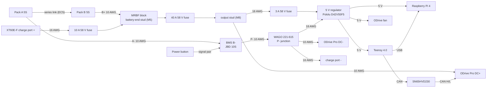

# Wiring

> **Draft.** This is the harness as designed now. It will be checked on the prototype and corrected before the verified
> release. Read the [safety reference](https://kinetiqgym.com/docs/SAFETY.html) before working on the battery or the mains.

This page covers the main build (battery). The budget build (wall power) is summarized at the end.

Every wire below is routed through the enclosure in the design model with its real insulation diameter, so the lengths are
routed lengths: add 10-15 % for the terminations. Gauges are minimums.

## Parts in the harness

| Part | Role |
|---|---|
| 2 x Thunder Power 5S LiPo (TP3300-5SR70 or TP2700-5SR70), EC5 leads | in series: 10S, 30-42 V |
| JBD 10-17S 80 A smart BMS, same port, set to 10S | switches the pack's negative side; charge, discharge and regen all pass through it |
| Blue Sea 5191 MRBF terminal fuse block with a Blue Sea 5176 40 A MRBF fuse (58 V DC) | main fuse, on the pack + |
| Littelfuse 0997 MINI 58 V fuses, 3 A and 10 A, in 58 V inline holders (Littelfuse 0FHM0003ZXJS) | 3 A: the regulator feed; 10 A: the charge port |
| WAGO 221-615 lever nut | the P- (switched negative) junction |
| ODrive Pro with its terminal block | motor controller |
| 10 k NTC thermistor (B3950) on the motor's stator | motor temperature, to the ODrive's motor-thermistor input |
| Pololu D42V55F5 regulator | 5 V for the Pi, the Teensy and the fan |
| Teensy 4.0 and an SN65HVD230 CAN board | controller; CAN to the ODrive |
| Raspberry Pi 4 and the 4 in 720 x 720 touch screen | user interface |
| Amass XT60E-F panel socket | charge port |
| 12 mm latching push switch | power button: a signal to the BMS soft-switch input |
| Noctua NF-A4x10 5V fan | ODrive cooling, through the machined heatsink |

## Power path

Every return goes through the BMS P- (the WAGO), so the BMS can switch everything off. Charging enters at the fuse block's
battery-end stud through its own 10 A fuse: it bypasses the 40 A fuse, and the BMS still controls it. Regenerative braking
current flows back through the 40 A fuse and the BMS into the pack.

## Wire list

| Wire | Gauge | From → to | Length |
|---|---|---|---|
| Pack B+ | 10 AWG | Pack B+ (EC5 on the pack lead) to the fuse block's battery-end stud: ring terminal under the M5 fender washer, tongue to the front | 153 mm |
| Series link | 10 AWG | Pack A+ to pack B- (EC5 pair), in the back step | 54 mm |
| Pack A- | 10 AWG | Pack A- (EC5) to the BMS B- pad (soldered) | 141 mm |
| ODrive DC+ | 10 AWG | Fuse block output stud (first ring, tongue to the right) to ODrive terminal pole 1 (ferrule) | 34 mm |
| ODrive DC- | 10 AWG | WAGO port 5 to ODrive terminal pole 2 (ferrule) | 92 mm |
| BMS P- | 10 AWG | BMS P- pad to WAGO port 4 | 151 mm |
| Motor phase A | 12 AWG | Motor lead exit, through the 12 mm grommet in the face plate, to ODrive terminal pole 3 (ferrule) | 371 mm |
| Motor phase B | 12 AWG | as phase A, to pole 4 | 387 mm |
| Motor phase C | 12 AWG | as phase A, to pole 5 | 378 mm |
| Motor thermistor | 2-wire lead | The NTC on the stator, along the phase leads, to the ODrive's motor-thermistor input | about the phase leads' length (not yet routed in the model) |
| Charge + (port to fuse) | 16 AWG | Charge port + (upper cup, per the panel marking) to the 10 A inline fuse | 35 mm |
| Charge + (fuse to block) | 16 AWG | 10 A inline fuse to the fuse block's battery-end stud (second ring under the washer) | 121 mm |
| Charge - | 16 AWG | Charge port - (lower cup) to WAGO port 3 | 124 mm |
| Regulator feed | 18 AWG | Fuse block output stud (second ring, tongue to the front) to the 3 A inline fuse | 96 mm |
| Regulator VIN+ | 18 AWG | 3 A inline fuse to the regulator VIN (screw terminal on its perfboard) | 330 mm |
| Regulator VIN- | 18 AWG | WAGO port 1 to the regulator GND in | 493 mm |
| Pi 5 V | 20 AWG | Regulator 5 V out to Pi GPIO pin 2 (1 x 3 Dupont housing on pins 2, 4 and 6) | 142 mm |
| Pi GND | 20 AWG | Regulator GND to Pi GPIO pin 6 | 153 mm |
| Fan + | 24 AWG | Regulator 5 V out to the ODrive fan (fan lead extended) | 491 mm |
| Fan - | 24 AWG | Regulator GND to the ODrive fan | 492 mm |
| Teensy VIN | 22 AWG | Regulator 5 V out to Teensy VIN (cut the VIN-VUSB pad) | 78 mm |
| Teensy GND | 22 AWG | Regulator GND to Teensy GND | 89 mm |
| Teensy to CAN board | 4 x 26 AWG | Teensy CAN TX/RX, 3.3 V and GND to the CAN transceiver board (short bundle on the board plate) | 24 mm |
| CAN bus | twisted pair | CAN H, CAN L and GND (twisted pair and drain) from the CAN board terminal to the ODrive CAN header (4-pin JST-GH plug) | 418 mm |
| USB | cable | Teensy (right-angle micro-USB) to the Pi's upper USB-A port (right-angle plug) | 186 mm |
| Screen video | flat HDMI cable | The screen's HDMI socket (its connector edge is at the top) back under the Pi's edge to the Pi's HDMI 0 | about 43 mm |
| Screen touch and power | USB-C cable | The screen's USB-C (right-angle plug) to the Pi's second USB stack, lower port (90-degree USB-A adapter) | 131 mm |
| Balance lead, pack A | 5S JST-XH | Cells 1-5 to the BMS balance header | 183 mm |
| Balance lead, pack B | 5S JST-XH | Cells 6-10 to the BMS balance header | 140 mm |
| BMS NTC | lead | BMS NTC lead to the 10 k probe taped to pack B's rear end face | 153 mm |
| Power switch | twisted pair | Power switch to the BMS soft-switch input | 120 mm |

## Notes

- **Every fuse and fuse holder must be rated 58 V DC.** Common 32 V automotive MINI blades and holders are not rated for a
  42 V pack.
- **Ring terminals:** 10 AWG with an M5 hole (pack +) and 16 AWG with an M5 hole (charge +) under the battery-end washer;
  10 AWG with a 5/16 in (M8) hole (ODrive DC+) and 18 AWG with a 5/16 in hole (regulator feed) on the output stud. Tighten
  the M8 nut to **75 in-lb maximum**, then fit the block's insulating cover.
- **The EC5 plugs on the pack leads are the service disconnect.** Plug them in with the BMS switched off.
- **BMS:** configure it for 10S and set over-charge to 4.20-4.25 V per cell in its app (some boards ship with LiFePO4
  settings). Check that your board has the soft-switch connector before you build the harness round it.
- **Battery current (design values):** about 14 A while holding 220 lb, and up to 36 A on a fast return at high force:
  the app caps the reel-in speed so it stays under 90 % of the 40 A fuse. Regenerative current is about 20 A at the most,
  under the 28 A regen limit. The WAGO 221-615 is rated about 30 A (UL).
- **Teensy:** cut the VIN-VUSB pad. It is powered by the regulator and also connected to the Pi by USB.
- **Motor phase leads:** 12 AWG through a 12 mm grommet, along the notches in the corner gussets. Measure the MP8085's own
  leads when it arrives and extend them if they are short.
- Crimp ferrules on every wire into the ODrive terminal block.
- **Charger:** 42.0 V (10S) Li-ion/LiPo CC/CV, 2-4 A, with an XT60 male plug. Charge only through the charge port, with the
  BMS connected.
- First power-up: the ODrive's input capacitors can trip the BMS's short-circuit protection at switch-on. If it does,
  lengthen the BMS short-circuit delay in its app.

## Budget build (wall power)

The budget build has no battery, BMS, main fuse block, WAGO, charge port, Raspberry Pi or screen.

- **Mains:** a floor box holds the Mean Well LRS-600N2-48 (48 V, 600 W) and a pre-wired mains inlet with its own fuse and
  lit rocker switch; a standard C13 cord goes to the wall. Earth runs from the inlet to the supply's earth terminal.
- **DC:** the supply's output to an XT60E-F socket on the floor box, up the rack on a 14 AWG two-core silicone cable with
  XT60 ends, into the XT60E-M port on the back of the unit, then to the ODESC's DC input.
- **Motor:** the three phase leads, extended in 12 AWG silicone with 5.5 mm bullet connectors, to the ODESC; the motor's
  Hall cable extended with JST-PH 6-pin leads (check its plug first).
- **Brake resistor:** two 1 Ω, 100 W resistors in series (2 Ω) on the inner plate, to the ODESC's brake resistor terminals.
  Braking energy goes into them, not into the supply, and they get hot.
- **5 V:** a Pololu APM81815 regulator (48 V in, a 47 µF capacitor across its input) on the perfboard powers the XIAO
  ESP32-C3 and the fan.
- **Signals:** the XIAO to the ODESC over UART; the knob (EC11) and the start/stop button to the XIAO; the AS5047P encoder
  board, which reads a magnet in the drum's end, to the ODESC.
- **Motor thermistor:** the NTC on the stator, with a 10 kΩ resistor and a 1 µF capacitor as its divider, to the ODESC's
  thermistor input.

Mains wiring can kill. Have it checked by someone qualified, check earth continuity from the inlet's earth pin, and keep the
floor box closed whenever it is plugged in.
