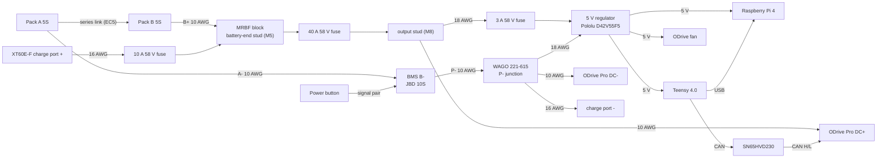

# Wiring

> **Draft.** This is the harness of the prototype being built now. It will be checked on the prototype and corrected before
> the verified release. Read the [safety reference](https://kinetiqgym.com/docs/SAFETY.html) before working on the battery.

This page covers the battery builds (main, MP80100 and C80100). The Lite (wall power) is summarized at the end.

Every wire below is routed through the enclosure in the design model with its real insulation diameter, so the lengths are
routed lengths: add 10-15 % for the terminations. Gauges are minimums.

## Parts in the harness

| Part | Role |
|---|---|
| 2 x Thunder Power 5S LiPo (TP3300-5SR70 or TP2700-5SR70), EC5 leads | in series: 10S, 30-42 V |
| JBD 10-17S 80 A smart BMS, same port, set to 10S | switches the pack's negative side; charge, discharge and regen all pass through it |
| Blue Sea 5191 MRBF terminal fuse block with a Blue Sea 5176 40 A MRBF fuse (58 V DC) | main fuse, on the pack + |
| Littelfuse 0997 MINI 58 V fuses, 3 A and 10 A, in 58 V inline holders (Littelfuse 0FHM0003ZXJS) | 3 A: the regulator feed; 10 A: the charge port |
| WAGO 221-615 lever nut | the P- (switched negative) junction |
| ODrive Pro with its terminal block | motor controller |
| Pololu D42V55F5 regulator | 5 V for the Pi, the Teensy and the fan |
| Teensy 4.0 and an SN65HVD230 CAN board | controller; CAN to the ODrive |
| Raspberry Pi 4 and the 4 in 720 x 720 touch screen | user interface |
| Amass XT60E-F panel socket | charge port |
| 12 mm latching push switch | power button: a signal to the BMS soft-switch input |
| Noctua NF-A4x10 5V fan | ODrive cooling |

## Power path

Every return goes through the BMS P- (the WAGO), so the BMS can switch everything off. Charging enters at the fuse block's
battery-end stud through its own 10 A fuse: it bypasses the 40 A fuse, and the BMS still controls it. Regenerative braking
current flows back through the 40 A fuse and the BMS into the pack.

## Wire list

| Wire | Gauge | From → to | Length |
|---|---|---|---|
| Pack B+ | 10 AWG | Pack B+ (EC5 on the pack lead) to the fuse block's battery-end stud: ring terminal under the M5 fender washer, tongue to the front | 165 mm |
| Series link | 10 AWG | Pack A+ to pack B- (EC5 pair), in the back step | 53 mm |
| Pack A- | 10 AWG | Pack A- (EC5) to the BMS B- pad (soldered) | 141 mm |
| ODrive DC+ | 10 AWG | Fuse block output stud (first ring, tongue to the right) to ODrive terminal pole 1 (ferrule) | 32 mm |
| ODrive DC- | 10 AWG | WAGO port 5 to ODrive terminal pole 2 (ferrule) | 95 mm |
| BMS P- | 10 AWG | BMS P- pad to WAGO port 4 | 141 mm |
| Motor phase A | 12 AWG | Motor lead exit, through the 12 mm grommet in the face plate, to ODrive terminal pole 3 (ferrule) | 314 mm |
| Motor phase B | 12 AWG | as phase A, to pole 4 | 315 mm |
| Motor phase C | 12 AWG | as phase A, to pole 5 | 364 mm |
| Charge + (port to fuse) | 16 AWG | Charge port + (upper cup, per the panel marking) to the 10 A inline fuse | 39 mm |
| Charge + (fuse to block) | 16 AWG | 10 A inline fuse to the fuse block's battery-end stud (second ring under the washer) | 118 mm |
| Charge - | 16 AWG | Charge port - (lower cup) to WAGO port 3 | 127 mm |
| Regulator feed | 18 AWG | Fuse block output stud (second ring, tongue to the front) to the 3 A inline fuse | 81 mm |
| Regulator VIN+ | 18 AWG | 3 A inline fuse to the regulator VIN (screw terminal on its perfboard) | 322 mm |
| Regulator VIN- | 18 AWG | WAGO port 1 to the regulator GND in | 450 mm |
| Pi 5 V | 20 AWG | Regulator 5 V out to Pi GPIO pin 2 (1 x 3 Dupont housing on pins 2, 4 and 6) | 145 mm |
| Pi GND | 20 AWG | Regulator GND to Pi GPIO pin 6 | 166 mm |
| Fan + | 24 AWG | Regulator 5 V out to the ODrive fan (fan lead extended) | 410 mm |
| Fan - | 24 AWG | Regulator GND to the ODrive fan | 431 mm |
| Teensy VIN | 22 AWG | Regulator 5 V out to Teensy VIN (cut the VIN-VUSB pad) | 78 mm |
| Teensy GND | 22 AWG | Regulator GND to Teensy GND | 89 mm |
| Teensy to CAN board | 4 x 26 AWG | Teensy CAN TX/RX, 3.3 V and GND to the CAN transceiver board (short bundle on the board plate) | 24 mm |
| CAN bus | twisted pair | CAN H, CAN L and GND (twisted pair and drain) from the CAN board terminal to the ODrive CAN header (4-pin JST-GH plug) | 347 mm |
| USB | cable | Teensy (right-angle micro-USB) to the Pi's upper USB-A port (right-angle plug) | 177 mm |
| Screen ribbon | 15-way FFC | Screen connector, behind the screen stand, to the Pi | - |
| Balance lead, pack A | 5S JST-XH | Cells 1-5 to the BMS balance header | 207 mm |
| Balance lead, pack B | 5S JST-XH | Cells 6-10 to the BMS balance header | 140 mm |
| BMS NTC | lead | BMS NTC lead to the 10 k probe taped to pack B's rear end face | 127 mm |
| Power switch | twisted pair | Power switch to the BMS soft-switch input | 130 mm |

## Notes

- **Every fuse and fuse holder must be rated 58 V DC.** Common 32 V automotive MINI blades and holders are not rated for a
  42 V pack.
- **Ring terminals:** 10 AWG with an M5 hole (pack +) and 16 AWG with an M5 hole (charge +) under the battery-end washer;
  10 AWG with a 5/16 in (M8) hole (ODrive DC+) and 18 AWG with a 5/16 in hole (regulator feed) on the output stud. Tighten
  the M8 nut to **75 in-lb maximum**, then fit the block's insulating cover.
- **The EC5 plugs on the pack leads are the service disconnect.** Plug them in with the BMS switched off.
- **BMS:** configure it for 10S and set over-charge to 4.20-4.25 V per cell in its app (some boards ship with LiFePO4
  settings). Check that your board has the soft-switch connector before you build the harness round it.
- **WAGO 221-615** is rated about 30 A (UL). The peak battery current is about 28 A for short pulls.
- **Teensy:** cut the VIN-VUSB pad. It is powered by the regulator and also connected to the Pi by USB.
- **Motor phase leads:** the gauge and exit point depend on your motor. The design assumes 12 AWG through a 12 mm grommet,
  along the notches in the corner brackets.
- Crimp ferrules on every wire into the ODrive terminal block.
- **Charger:** 42.0 V (10S) Li-ion/LiPo CC/CV, 2-4 A, with an XT60 male plug. Charge only through the charge port, with the
  BMS connected.
- First power-up: the ODrive's input capacitors can trip the BMS's short-circuit protection at switch-on. If it does,
  lengthen the BMS short-circuit delay in its app.

## Lite (wall power)

The Lite has no battery, BMS, main fuse block, WAGO, charge port or power button. Its harness (22 wires):

- **Mains:** an IEC C14 inlet in the right cover's back step. Line runs through the rocker switch to the supply's AC input
  (CN1), neutral straight to CN1. Earth runs from the inlet to the supply's earth screw and on to the M4 earth stud in the
  base plate. Use insulated 6.3 mm quick-disconnects on the inlet and switch tabs.
- **DC:** 10 AWG from the Mean Well LOP-600-36 (36 V) to the ODrive S1's DC pads.
- **Motor:** the three phases along the same floor channel as the battery build, to the S1's phase pads.
- **Brake resistor:** two 1 Ω, 50 W resistors in series (2 Ω) on the base plate, to the S1's R+ and R- pads. Regenerative
  energy goes into them, not into the supply.
- **5 V:** the regulator is fed from the supply's 12 V auxiliary output (CN2) and powers the fan and the XIAO ESP32-C3.
- **Signals:** the XIAO to the CAN board, CAN from the CAN board to the S1 (4-pin JST-GH), and the knob (EC11) to the XIAO.

Mains wiring can kill. Have it checked by someone qualified, check earth continuity from the inlet's earth pin to the base
plate and the rear plate, and keep the covers on whenever the unit is plugged in.
