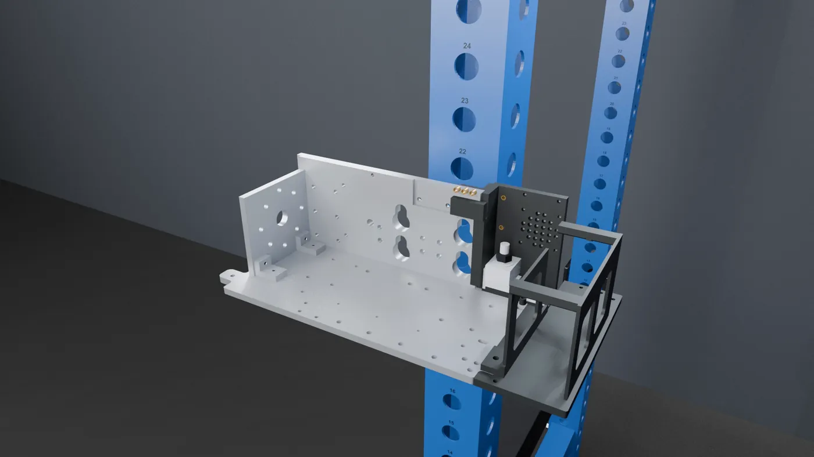
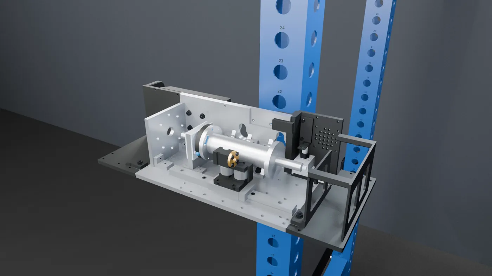
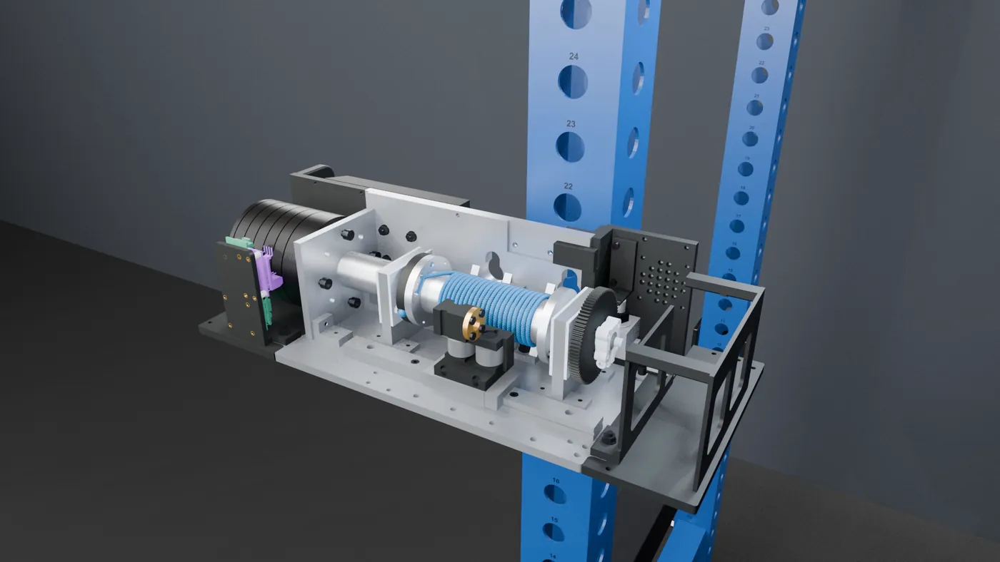
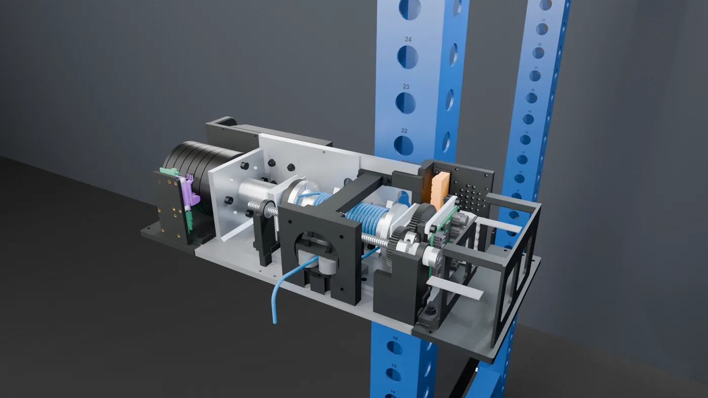
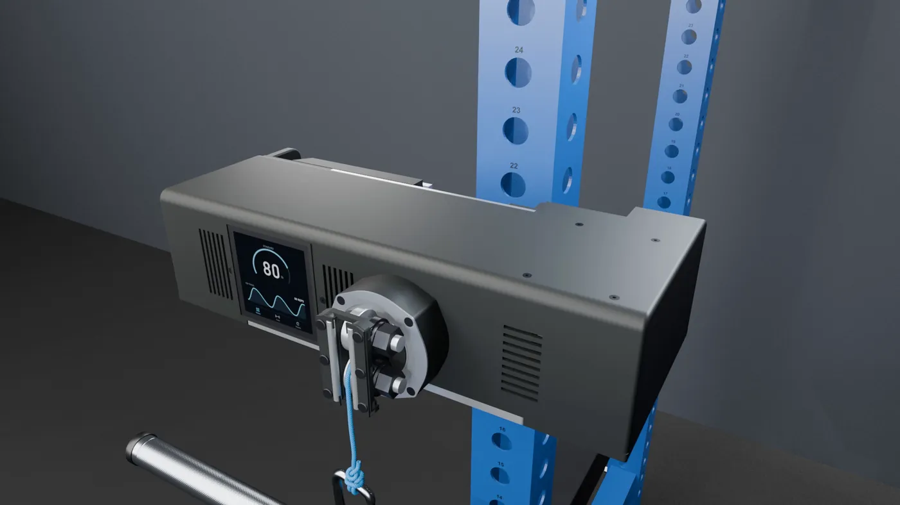
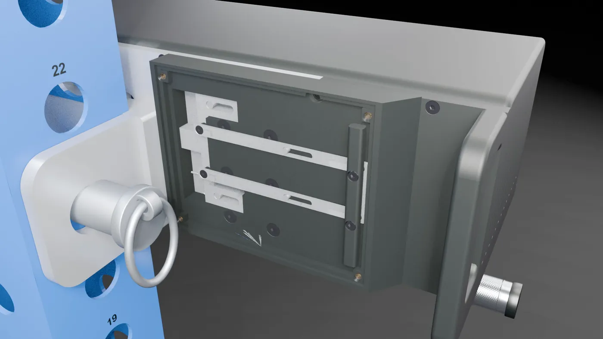

# The build, illustrated

Stills from the build animation of the main build: the bolted aluminum frame, the drum and level-wind, the motor, the
electronics, the covers and the rack mount. They are renders of an earlier revision, with the previous motor, a larger drum
and the earlier rack side: the current main build is longer, on the MP8085 motor and a 7/8 in drum. They show the layout and
the build order; they are not a confirmed fabrication or assembly procedure. The written [build order](build.md) has the steps. Both are drafts until the prototype has been built and
load-tested.

## 1. The bolted frame

The base, rear and motor face plates are 6061 aluminum and bolt together into one frame that carries every load, with
three corner gussets at the rear joint. Every load-bearing screw goes to a nut in a window cut through the plate. The printed motor-end and battery-end pieces bolt to it, with the main
fuse block.

## 2. The drum and the level-wind

The level-wind rail and traveller go on the base plate first. The drum is built on the bench (hub, rope laced and clamped,
shaft, gear, coupling) and lowered in on its two milled bearing holders. The drum's gear drives the lead screw, which moves
the traveller so the rope lays evenly.

## 3. The motor

The motor bolts to the face plate and drives the drum directly through one clamp coupling: no belt and no gearbox.

## 4. Electronics, battery and wiring

The ODrive sits on its bracket, the control boards on the front plate, and the two battery packs slide into their cradle. The
harness goes in last, fuses first. See the [wiring reference](wiring.md).

## 5. Covers, screen and exit

The screen, Raspberry Pi, BMS and fan hang from the covers, which lower over the frame. The swivelling exit and the rope go on
last. The screen content in the animation is an interface concept.

## 6. On the rack

The rack side goes on a 3 in rack upright with one hitch pin and a lever clamp (the render shows an earlier version). The unit
hangs on it and a spring latch locks it in place; pull the ring to lift it off.

## What comes next

The CAD, build files and software are released together after the prototype is tested. Follow the
[roadmap](roadmap.md), or join the build list and kit waitlist at [kinetiqgym.com](https://kinetiqgym.com/#join).

Animation imagery from the Kinetiq Gym project, shared with the documentation under CC BY-SA 4.0. Third-party components are
shown for their role in the design; this does not imply endorsement.
